# Entra Cloud Sync Lab: Copying an Active Directory Domain to Microsoft Entra ID and Testing MFA

An on-premises domain, copied to the cloud with Microsoft Entra Cloud Sync, scoped by OU, and then tested: does a synced user get multi-factor authentication (MFA) at the cloud sign-in, and what does that MFA not protect? It runs on the free tier of Microsoft Entra ID, so the only cost is the server you already run for the IAM lab.

> **This lab builds on top of another lab.** It starts from the domain controller, the OUs, the 20 users and the two leavers that the [Identity Lifecycle Lab](https://github.com/dmill1mb/azure-iam-lifecycle-lab) builds, and it does not rebuild any of them. Complete Steps 1 to 14 of that lab first, and leave its server in place. Everything here is meant to be read and run on top of it.

You do not need any Active Directory or Entra experience to follow this. Each step says what it does, why it matters, exactly what to do, and what you should see when it works.

## What this lab is for

A directory on its own is a list of accounts on one server. Most companies also use cloud services, and those sign people in against a second directory in the cloud. Something has to keep the two lists in step, and someone has to know what protects each side.

- **Sync:** the 18 active staff accounts are copied to Microsoft Entra ID. The scope is the Staff OU, so the leavers are never sent to the cloud.
- **Check the scope before trusting it:** one user at a time goes through the sync before the real sync is turned on.
- **Test the cloud sign-in:** a synced user is forced to register for MFA, the same as a cloud-only user.
- **Show the gap:** Remote Desktop to the domain controller, with the same account, asks for no MFA at all.
- **Find out what leaving the scope does:** the IAM lab moves leavers out of the Staff OU. This lab shows what that does to an account that is already in the cloud.
- **Explain the paid version:** a reading step says what a paid Entra ID plan adds, without claiming it was tested.
- **Take it down in the right order:** the sync has to remove its own users before the configuration is deleted, and then the agent, the sync account and the server go.

## Words you will see

| Word | What it means here |
|---|---|
| Active Directory (AD) | Microsoft's directory service on the server. It stores the users, groups and computers and decides who can sign in. |
| Domain controller (DC) | The server that holds the directory. In this lab it is DC01, the server from the IAM lab. |
| OU (organizational unit) | A folder inside the directory used to organize accounts. |
| Distinguished name (DN) | The full address of an object in the directory, for example `CN=Maya Johnson,OU=Finance,OU=Staff,DC=iamlab,DC=local`. |
| Microsoft Entra ID | Microsoft's cloud directory (formerly Azure Active Directory). It decides who can sign in to the Azure portal and Microsoft 365. |
| Tenant | Your organization's own copy of Entra ID. Your Azure subscription already sits inside one. |
| Entra Cloud Sync | A tool that copies accounts from Active Directory to Entra ID. A small agent on the domain controller sends the changes out over HTTPS. |
| Scope | Which part of the directory the sync is allowed to copy. Here, the Staff OU. |
| UPN (user principal name) | The sign-in name that looks like an email address. |
| gMSA (group managed service account) | A service account whose password Windows creates and rotates by itself, so nobody knows it. |
| MFA (multi-factor authentication) | Signing in with something more than a password, such as a number approved in a phone app. |
| Security defaults | A free Entra ID setting that makes every user register for MFA and always challenges administrators. |
| run-command | An Azure feature that sends a script to a VM and returns the output, with no remote desktop session. |

## Architecture

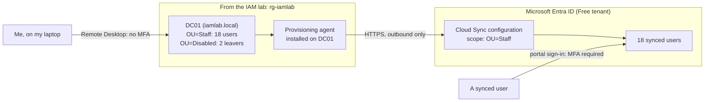

Apart from installing the agent and the Remote Desktop test, scripts never open a remote desktop session. `az vm run-command` pushes each script to DC01 and returns the output.

## What's inside

```
entra-cloud-sync-lab/
├── README.md
├── images/                       ← the screenshots used in this README
└── scripts/
    └── 21-set-test-passwords.ps1 ← known password for two test users (lab shortcut)
```

There is no Terraform here, because the server comes from the IAM lab. The script number continues that lab's numbering, which runs from 00 to 20.

## Before you start

**Finish the IAM lab first.** You need Steps 1 to 14 of the [Identity Lifecycle Lab](https://github.com/dmill1mb/azure-iam-lifecycle-lab) done and the server still in place. Step 13 matters most: it creates the two leavers this lab relies on, in `OU=Disabled`. Steps 15 to 17 of that lab are optional here. Keep the folder you built it in, because Step 1 below reads the vault name from it.

You also need:

1. **A Microsoft Entra tenant.** Your Azure subscription already has one. A free Azure account comes with Entra ID Free, which is all this lab uses.
2. **A smartphone with the free Microsoft Authenticator app**, for the MFA sign-ins in Steps 2, 3 and 7.
3. **Azure CLI, Git and Visual Studio Code**, which you installed for the IAM lab.

The server bills by the hour while it runs, so Step 11 deletes it. Everything else in this lab is free.

Each step below says **what this step does**, **what to do**, and **what you should see**. What you should see is what I observed in my own lab.

## Step 1: Pick up where the IAM lab left off

**What this step does.** It starts the server if it is stopped, gets the files for this lab, reloads the admin password from the Key Vault, and defines the one short command that sends a script to the server. Then it checks that the directory is in the state this lab expects.

**What to do.** Sign in to Azure and start the server. The command is safe to run if it is already running:

```powershell
az login
az vm start -g rg-iamlab -n DC01
```

Download this lab's files and open the folder in Visual Studio Code, so the terminal starts inside it:

```powershell
git clone https://github.com/dmill1mb/entra-cloud-sync-lab.git
code entra-cloud-sync-lab
```

In the terminal inside Visual Studio Code, load the password. The vault name comes from the folder where you built the IAM lab, so change into that folder first and change back afterwards. Replace the path with yours:

```powershell
cd <the folder where you built the IAM lab>
$vault = terraform output -raw key_vault_name
$env:TF_VAR_admin_password = az keyvault secret show --vault-name $vault --name vm-admin-password --query value -o tsv
$env:TF_VAR_admin_password.Length
cd <the folder of this lab>\scripts
```

Define the command that sends a script to DC01:

```powershell
function Send-ToDC {
    param([string]$ScriptFile)
    az vm run-command invoke -g rg-iamlab -n DC01 --command-id RunPowerShellScript --scripts "@$ScriptFile" --query "value[0].message" -o tsv
}
```

Check the directory:

```powershell
Set-Content -Encoding ascii check.ps1 -Value '(Get-ADUser -Filter * -SearchBase "OU=Staff,DC=iamlab,DC=local").Count; (Get-ADUser -Filter * -SearchBase "OU=Disabled,DC=iamlab,DC=local").Count'
Send-ToDC check.ps1
```

**What you should see.** The password check prints a number, the length of your password. If it prints 0 the password did not load, so stop and fix that first. The directory check prints `18` and then `2`: 18 users under Staff and 2 leavers in Disabled. If your numbers differ, go back to Step 13 of the IAM lab. If you close the terminal, repeat the password and `Send-ToDC` parts of this step in the new window.

## Step 2: Check your Entra tenant and create the sync account

**What this step does.** The next steps connect this on-premises directory to Microsoft Entra ID, Microsoft's cloud directory (it used to be called Azure Active Directory). Your Azure subscription already sits inside a **tenant**, which is your own copy of Entra ID. This step checks what your tenant includes and creates a cloud-only account for the sync agent to sign in with.

Why a new account: the agent's sign-in needs the **Hybrid Identity Administrator** role and, according to Microsoft, cannot be a guest account. If you signed up for Azure with a personal email address, your own admin account may show up as a guest, with `#EXT#` in its user name. Look in **Users** to check. Creating a dedicated account is cleaner either way.

**Before you run it.** When the new account signs in for the first time, will it go straight in, or be asked for something more?

**What to do.**

1. Open the Entra admin center at `entra.microsoft.com` and sign in with the account you use for Azure. From the Azure portal you can also search for "Microsoft Entra ID".
2. On the **Overview** page, note the license shown for your tenant. Then open **Properties** and look at **Manage security defaults**. A free Azure account has Entra ID Free with security defaults turned on. Everything in this lab works on Free.
3. Go to **Users**, then **New user**, then **Create new user**. Use the user name `syncadmin`, the display name `Sync Admin` and a password you will remember. On the **Assignments** tab add the role **Hybrid Identity Administrator**, then create the user.
4. Open a private browser window, go to `entra.microsoft.com` and sign in as `syncadmin@<your-tenant>.onmicrosoft.com`. Your tenant's domain is on the **Overview** or **Custom domain names** page.

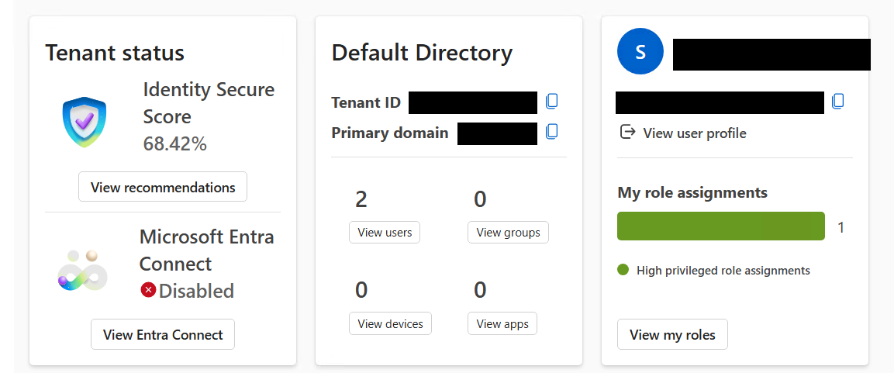

**What you should see.** The new account is not allowed straight in. It is asked to set up Microsoft Authenticator on a phone, scan a code and approve a number, because **security defaults** make every user register for multi-factor authentication (MFA) the first time they sign in. Install the Authenticator app, finish the registration and, if you are asked "Stay signed in?", answer No.

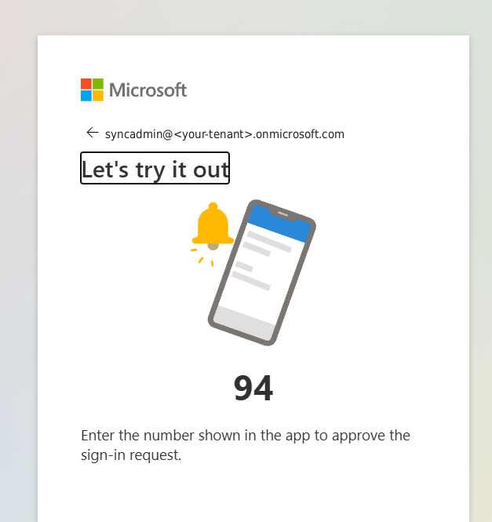

This is the first control from the sync work worth naming. It supports NIST SP 800-53 IA-2 (identification and authentication): the cloud side requires a second factor for the account that can reconfigure the sync.

## Step 3: Install the provisioning agent on DC01

**What this step does.** The provisioning agent is a small program on the domain controller. It reads the directory and sends the changes to Entra ID over an outbound HTTPS connection, so you open no inbound firewall port. It runs under a **gMSA** (group managed service account), an account whose password Windows creates and rotates by itself, so nobody ever knows or types it.

Microsoft allows the agent on a domain controller, and that is what this lab does to stay on one server. In a real environment I would put it on a separate member server, because anything installed on a domain controller becomes part of the most trusted system in the network.

**Before you run it.** The installer will ask for two different sets of credentials. Which two, and why does it need both?

**What to do.**

1. Start the VM if it is deallocated: `az vm start -g rg-iamlab -n DC01`.
2. Open a remote desktop session to DC01. In the IAM lab every script ran from outside, but the installer has a window, so this is the first time you need the desktop. Find the VM's public address, copy the admin password to your clipboard and start the Remote Desktop client:

```powershell
$ip = az vm list-ip-addresses -g rg-iamlab -n DC01 --query "[0].virtualMachine.network.publicIpAddresses[0].ipAddress" -o tsv
$env:TF_VAR_admin_password | Set-Clipboard
mstsc /v:$ip
```

3. Sign in as `IAMLAB\labadmin` and paste the password. Remote Desktop shares your clipboard with the VM, which is why pasting works. Back in your terminal, empty the clipboard: `Set-Clipboard -Value " "`. If the connection times out, the network security group only allows the IP address you put in `terraform.tfvars`, and yours may have changed.
4. Inside the VM, open a browser, sign in to `entra.microsoft.com` as `syncadmin`, and go to **Entra ID**, **Entra Connect**, **Cloud sync**, **Agents**. Choose **Download agent**, accept the terms and run `AADConnectProvisioningAgentSetup.exe` from the Downloads folder.
5. Click through the first screens until you reach **Connect Microsoft Entra ID**. Click the sign-in button and try to sign in as `syncadmin`.

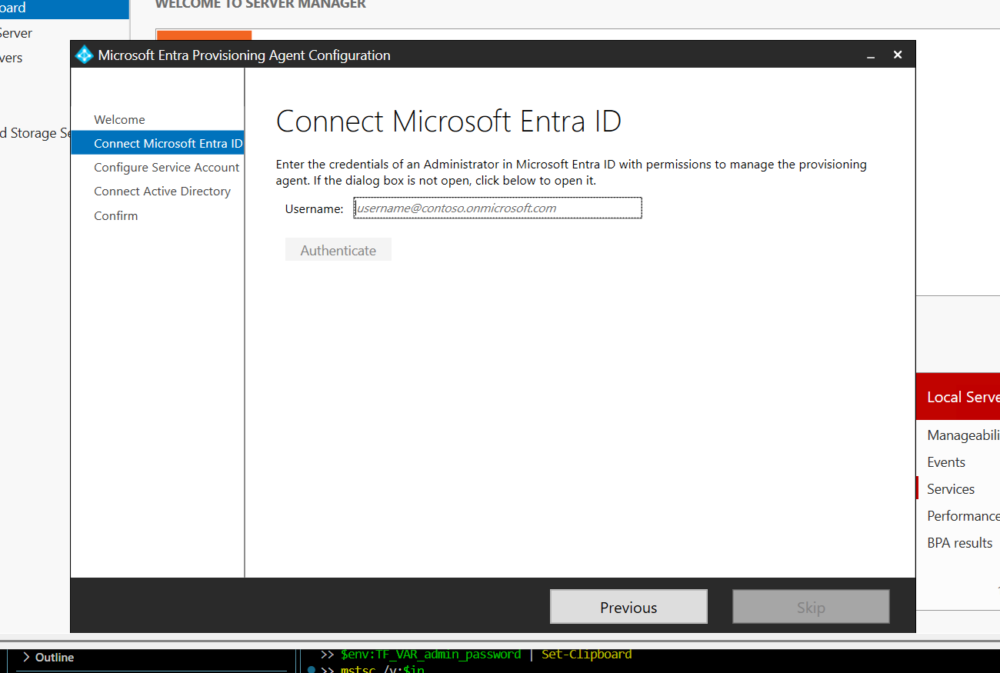

**What you will see: the sign-in is blocked.** The sign-in window shows an error saying the content is blocked by **Internet Explorer Enhanced Security Configuration**. Do not work around it yet. This is what happens on a server when you do nothing about it.

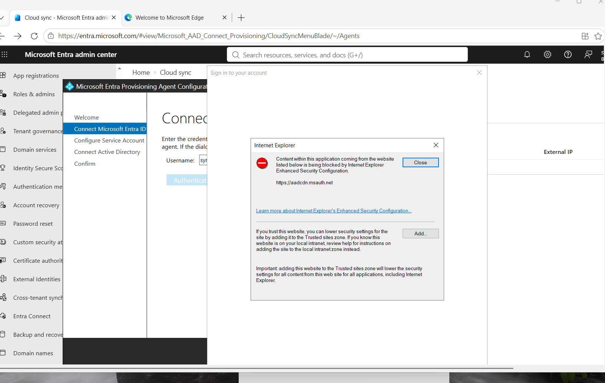

**Why it happens.** Windows Server turns on Enhanced Security Configuration (ESC) by default for administrators. It blocks web content from sites that are not on a trusted list, and the installer's sign-in window uses the same engine as Internet Explorer. The window tries to load files from `aadcdn.msauth.net`, a Microsoft sign-in site, and ESC refuses them.

**The lab shortcut.** Turn ESC off for administrators, run the sign-in, then turn it back on:

1. Close the installer. In **Server Manager**, click **Local Server** and click the **On** next to **IE Enhanced Security Configuration**.
2. Under **Administrators**, choose **Off** and click **OK**.
3. Start `AADConnectProvisioningAgentSetup.exe` again and go through the screens to **Connect Microsoft Entra ID**.

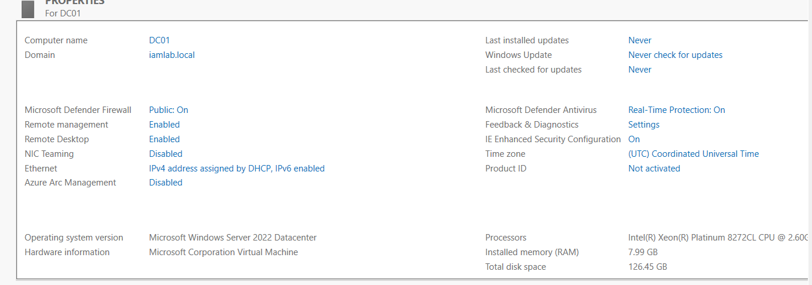

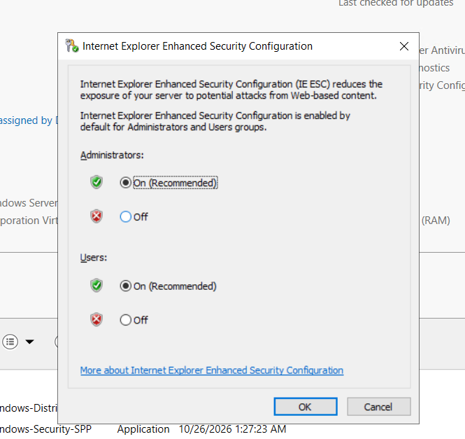

**What real practice looks like.** Leaving a protection off on a domain controller is not acceptable. In a real environment you keep ESC on and add the Microsoft sign-in sites to the **Trusted sites** list, or you run the install from a dedicated server. Here I use the shortcut for ten minutes and turn it back on at the end of this step.

6. Sign in as `syncadmin`. You will be asked to approve a number in the Authenticator app, the same MFA you registered in Step 2.
7. On **Configure service account**, choose to create a gMSA. This is the first of the two credentials: it asks for a **domain administrator** because creating a service account in Active Directory takes one. Enter `IAMLAB\labadmin` and its password. Copy the password again on your laptop with `$env:TF_VAR_admin_password | Set-Clipboard`, paste it here, then empty the clipboard again.

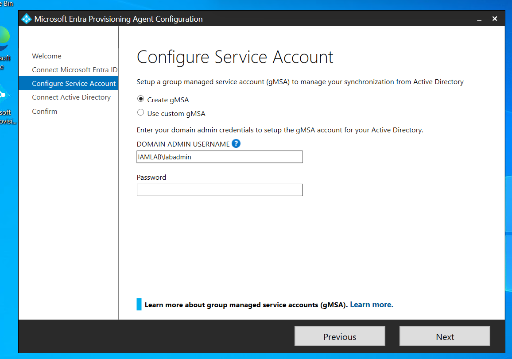

8. On **Connect Active Directory**, add the domain `iamlab.local`. It asks for the domain administrator again so the agent can read the directory. Click **Next**.

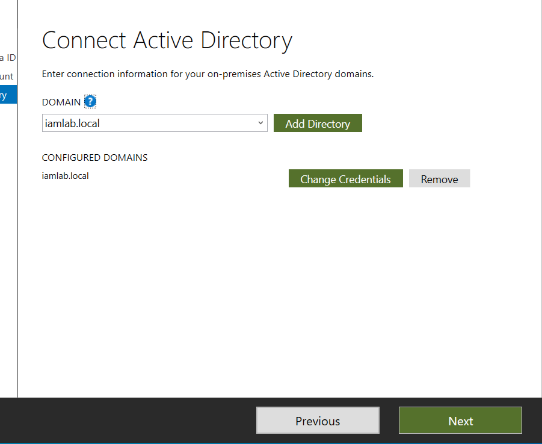
9. On **Confirm**, check that it lists the `syncadmin` account and the domain `iamlab.local`, then click **Confirm**.

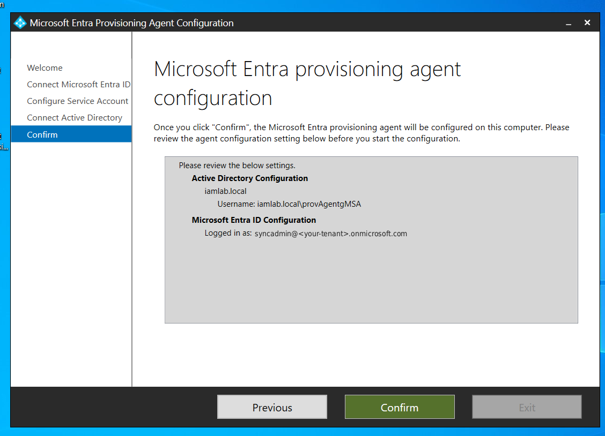

10. Wait for **Installation complete**.

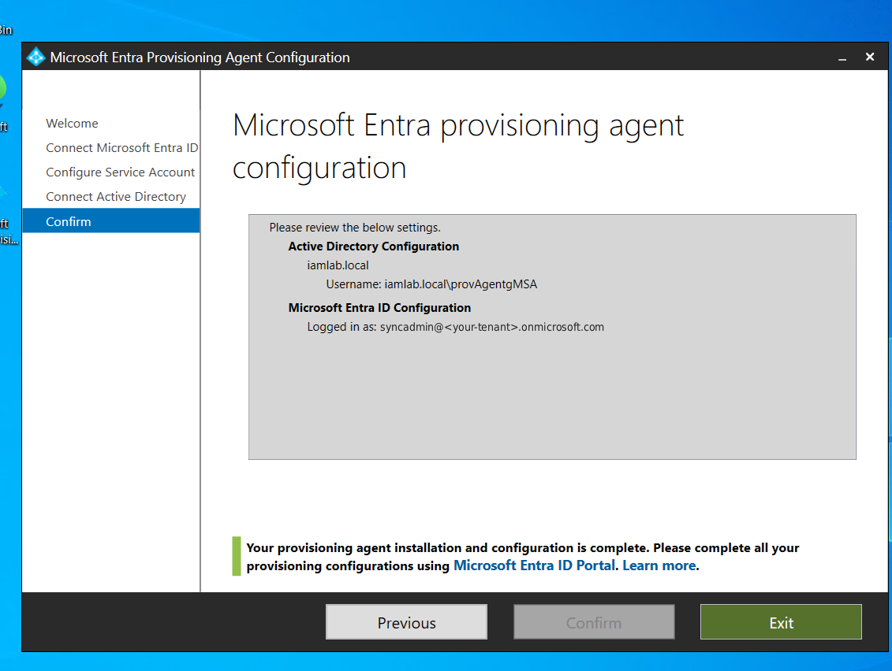

11. Turn ESC back on: **Server Manager**, **Local Server**, **IE Enhanced Security Configuration**, **Administrators**, **On**, **OK**.
12. In the Entra admin center, go to **Entra Connect**, **Cloud sync**, **Agents** and refresh.

**What you should see.** The two credentials are the two ends of the job. `syncadmin` proves to the **cloud** side that you may connect a directory, and `labadmin` proves to the **on-premises** side that you may create a service account and read the domain. The Agents page lists one agent for `iamlab.local` with the status **active**.

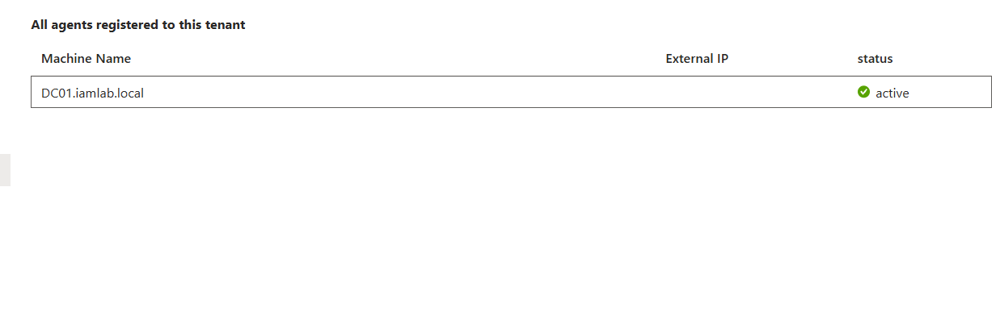

## Step 4: Create the sync configuration and scope it

**What this step does.** The agent is only the pipe. A **configuration** tells Entra what to copy through it. The most important setting is the **scope**: which part of the directory is allowed to leave the building. Scoping to the `Staff` OU means the leavers, who sit in `OU=Disabled`, are never sent to the cloud.

**Before you run it.** The directory has 20 users and two of them are leavers. How many users do you expect to sync?

**What to do.**

1. In the Entra admin center, go to **Entra ID**, **Entra Connect**, **Cloud sync**. Choose **New configuration**, then **AD to Microsoft Entra ID sync**.
2. Select the domain `iamlab.local`. Leave **Password hash sync** ticked and create the configuration. Password hash sync sends a scrambled form of each password to Entra ID, so a user can sign in to the cloud with the same password.
3. Open the new configuration and go to **Scoping filters**. Choose **Sync selected organizational units**.
4. In the box **Distinguished name of object**, type the whole name `OU=Staff,DC=iamlab,DC=local` once and click **Add** once.
5. Click **Save**.
6. Leave the configuration disabled. Do not turn it on yet.

A common mistake is to type the name in pieces, `OU=Staff`, then `DC=iamlab`, then `DC=local`. Each piece becomes its own entry, and `DC=iamlab,DC=local` on its own means the whole domain. If your list shows three rows, delete them and add the single full name.

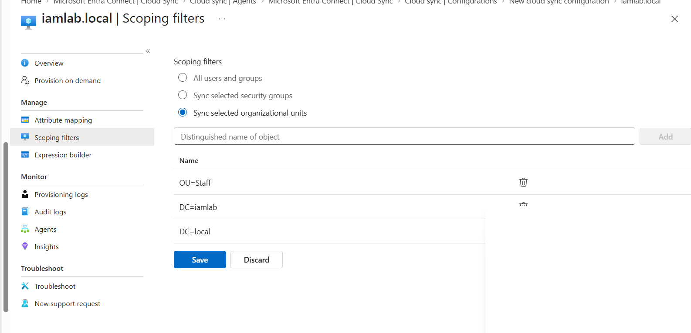

**What you should see.** The list under the box shows exactly one row, `OU=Staff,DC=iamlab,DC=local`. After you save, the **Save** and **Discard** buttons turn grey. That means it is saved, not that something is wrong. Reopen **Scoping filters** to check that the single row is still there.

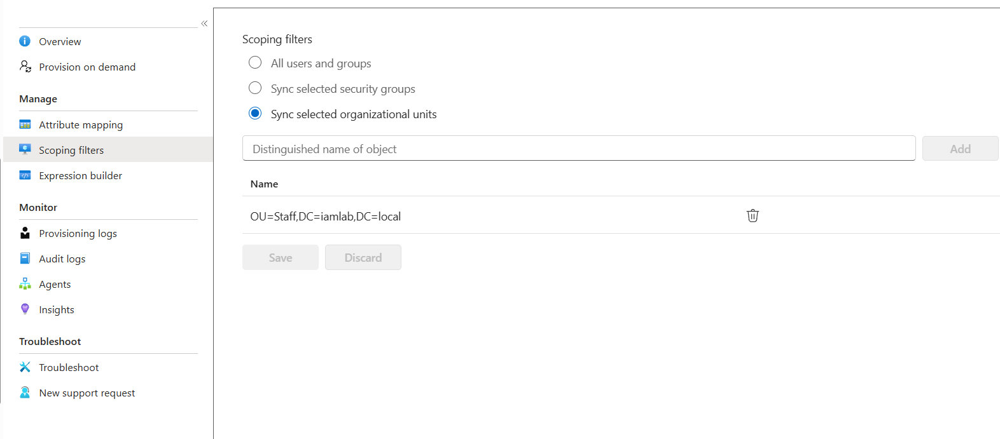

## Step 5: Test the scope before you turn the sync on

**What this step does.** **Provision on demand** sends one named user through the whole sync, using your configuration, without turning the sync on. It is how you check the scope on one person before you trust it with the whole directory. It is a real write: a user that passes the test is created in Entra ID.

**Before you run it.** `mjohnson` is a Finance user in a sub-OU under `Staff`. `lortega` is a disabled leaver in `OU=Disabled`. What do you expect for each?

**What to do.** The Provision on demand box needs the **full distinguished name**, not a user name or a display name. Typing `mjohnson` or `Maya Johnson` gives a `ResourceNotFound` error that looks like a scope problem but is only the wrong kind of input. Look the names up:

```powershell
@'
Get-ADUser -Filter "SamAccountName -eq 'mjohnson' -or SamAccountName -eq 'lortega'" | Select-Object SamAccountName, DistinguishedName | Format-List | Out-String
'@ | Set-Content check.ps1 -Encoding ascii
Send-ToDC check.ps1
```

In your configuration, open **Provision on demand**, paste `CN=Maya Johnson,OU=Finance,OU=Staff,DC=iamlab,DC=local` and click **Provision**. Then use **Provision another user** with `CN=Luis Ortega,OU=Disabled,DC=iamlab,DC=local`.

To check that it is the leaver's **location** and not the **disabled state** that keeps him out, create one throwaway account that is enabled but sits in the same OU, and test that as well:

```powershell
@'
$pw = ConvertTo-SecureString ([guid]::NewGuid().ToString() + 'Aa1!') -AsPlainText -Force
New-ADUser -Name "Scope Test" -SamAccountName scopetest -GivenName Scope -Surname Test -Path "OU=Disabled,DC=iamlab,DC=local" -AccountPassword $pw -Enabled $true -Description "Scope test - delete after lab"
Get-ADUser scopetest | Select-Object SamAccountName, Enabled, DistinguishedName | Format-List | Out-String
'@ | Set-Content check.ps1 -Encoding ascii
Send-ToDC check.ps1
```

Run Provision on demand with `CN=Scope Test,OU=Disabled,DC=iamlab,DC=local`.

**What you should see.** For `mjohnson`, all four steps pass: import, in scope, matched, and **Successfully created object in Microsoft Entra ID**. The export details name `mjohnson@iamlab.local` and carry real data such as the department Finance, the title Accountant and the description "Joiner ticket INC-1001". A user in a sub-OU counts as in scope.

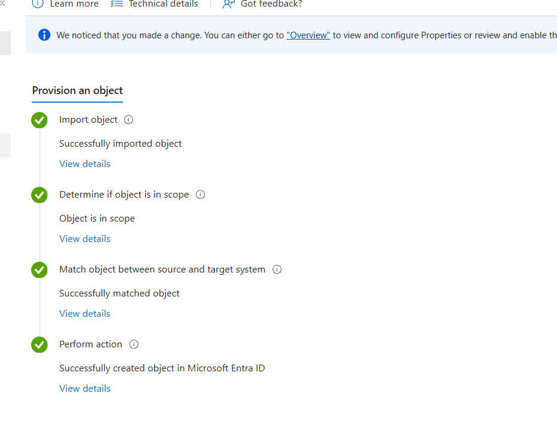

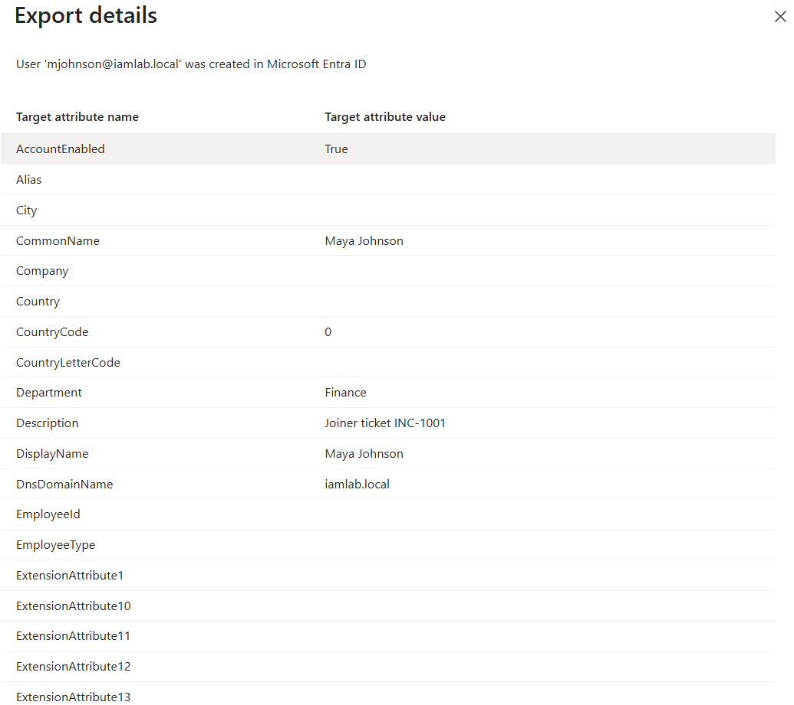

For `lortega` and for `scopetest`, the result is the same. The import and the "in scope" check both show a green tick, which is misleading, and then the last step says **Object was skipped** with `SkipReason: JoinNotFound`. An enabled account in `OU=Disabled` is skipped exactly like a disabled one. So the account state does not decide it. The OU does.

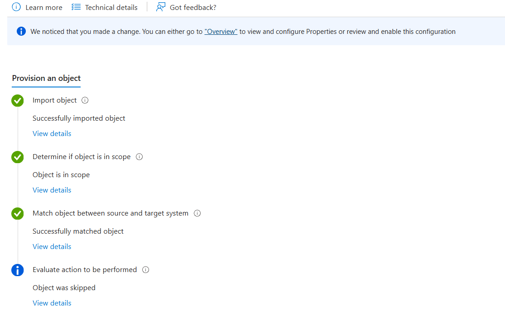

The Provisioning logs record the action for these as **Delete**, marked Skipped. The service treats an object outside the scope as one to remove from the cloud. Because there is no cloud copy yet, there is nothing to remove, so it is skipped. Step 9 shows what that means for a user who is already synced.

## Step 6: Turn the sync on

**What this step does.** It starts the real synchronization of everything in scope.

**Before you run it.** How many users will the Entra **Users** list show afterwards, and will `lortega` be one of them?

**What to do.**

1. Open the configuration's **Overview** page and choose **Review and enable**. Check that the summary shows the domain `iamlab.local`, password hash sync **Enabled**, prevent accidental deletion **Enabled** with a threshold of 500, and the scope `OU=Staff,DC=iamlab,DC=local`. Then click **Enable configuration**.

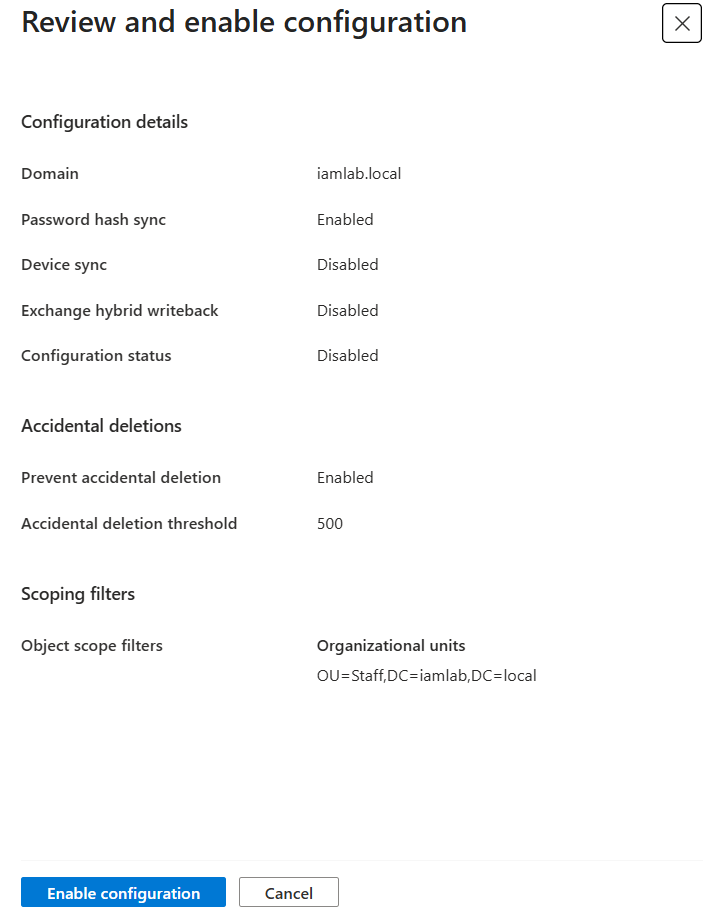

2. Wait about five minutes. Then open **Entra ID**, **Users** and click **Refresh**.
3. Open **Provisioning logs** and look at the newest rows.
4. Go to **Entra ID**, **Entra Connect**, **Connect Sync**.

**What you should see.** The Users list shows **20 users found**: the 18 synced users, your own account and `syncadmin`. The synced ones show **On-premises sync enabled: Yes**. If your tenant already had other users, the total is higher, but exactly 18 rows say Yes. Neither leaver is there. Maya Johnson was already created in Step 5, so the log shows 17 new Creates in about 12 seconds, all with the status Success.

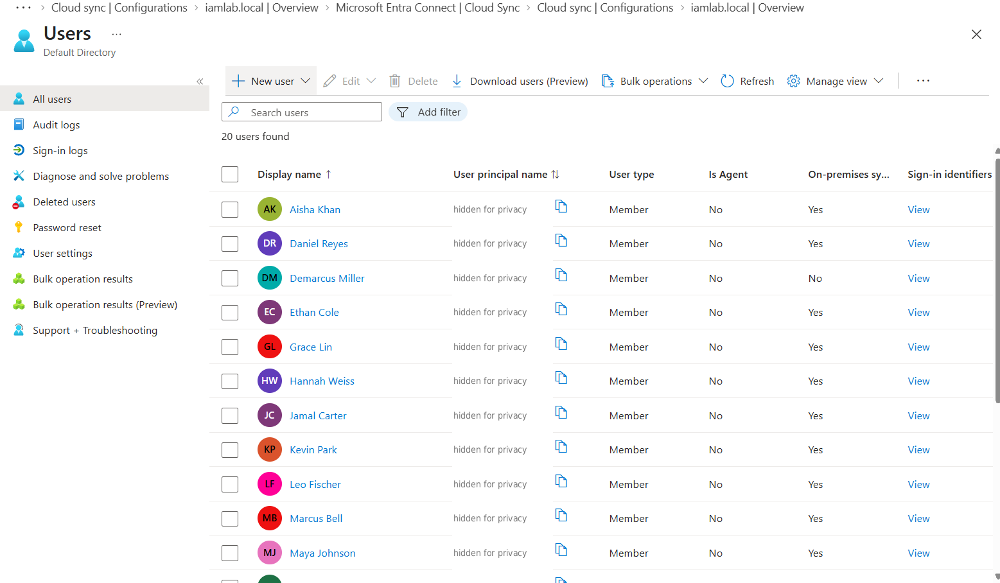

The configuration's status reads **Healthy**.

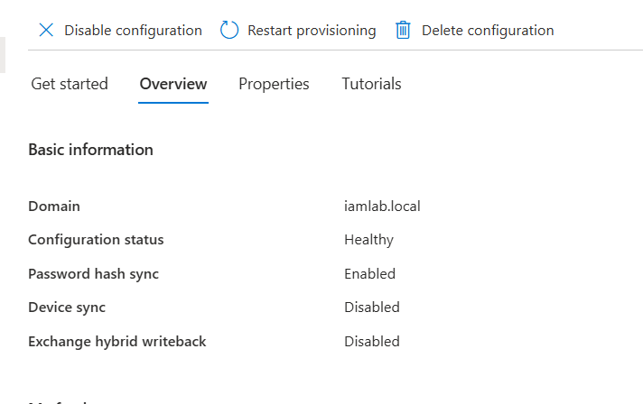

Open one synced user. The user name is not `mjohnson@iamlab.local`. It is `mjohnson@<your-tenant>.onmicrosoft.com`. The domain `iamlab.local` cannot be verified as a real internet domain, so Entra replaces it with your tenant's own.

The **Connect Sync** page, which said **Disabled** at the start of the lab, now says **Enabled**, with the last sync under an hour ago, even though you never installed classic Connect Sync. The page reports the tenant's directory-sync state, not one particular tool. Federation, Seamless single sign-on and Pass-through authentication all stay **Disabled**. Password hash sync is the only way these users sign in.

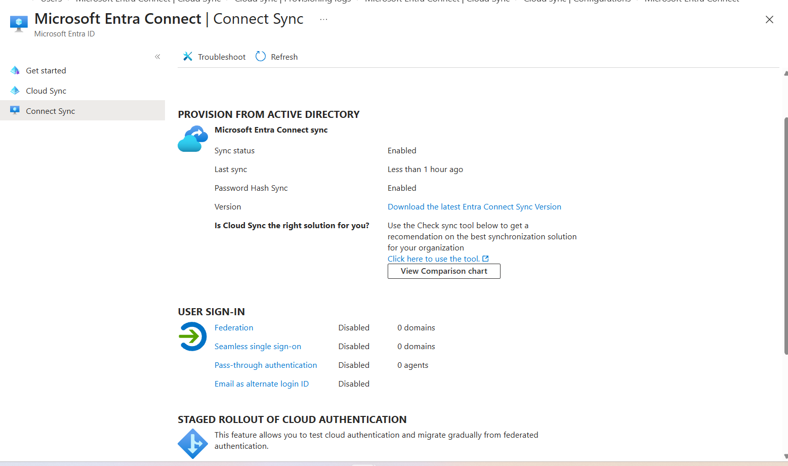

Everything so far works on the Free tier. This supports NIST SP 800-53 AC-2(1), automated account management: accounts in the directory appear in the cloud without anyone creating them by hand.

## Step 7: Sign in as a synced user

**What this step does.** It tests the question that started this lab: do the users from the directory get the MFA protection the cloud applies? The 18 synced users have random passwords nobody knows, so first give two of them a known one.

**Before you run it.** `mjohnson` signs in to the Azure portal with the password from the directory. Does the portal let him straight in, or ask for something first?

**What to do.** The script `21-set-test-passwords.ps1` resets the passwords of `mjohnson` and `ohaddad`. It follows the same rules as the other scripts: it ships in dry-run mode, and the password is never written in the file or printed. Run the dry run:

```powershell
Send-ToDC 21-set-test-passwords.ps1
```

Then open the file, change `$dryRun = $true` to `$dryRun = $false` and save it. Make a password on your laptop, copy it to your clipboard without printing it, and run the script with the password as a parameter:

```powershell
$pw = -join ((48..57)+(65..90)+(97..122) | Get-Random -Count 16 | ForEach-Object {[char]$_}); $pw += '-9aZ'
Set-Clipboard $pw
az vm run-command invoke -g rg-iamlab -n DC01 --command-id RunPowerShellScript --scripts "@21-set-test-passwords.ps1" --parameters "TestPassword=$pw" --query "value[0].message" -o tsv
```

If you run it in real mode without the `--parameters` part, it stops with a message and changes nothing. Wait about two minutes for the new password to reach Entra ID. Then open a **fresh private window**, go to `portal.azure.com` and sign in as `mjohnson@<your-tenant>.onmicrosoft.com`, pasting the password. When you finish, empty the clipboard with `Set-Clipboard -Value " "`.

**What you should see.** The dry run prints "DRY RUN: would set a new password" for both users. The real run prints "Password set". The sign-in accepts the password, which shows password hash sync works on the Free tier, and then asks `mjohnson` to set up Microsoft Authenticator. Security defaults apply to synced users exactly as they do to cloud-only users. Finish the registration, approve the number, and you reach the portal.

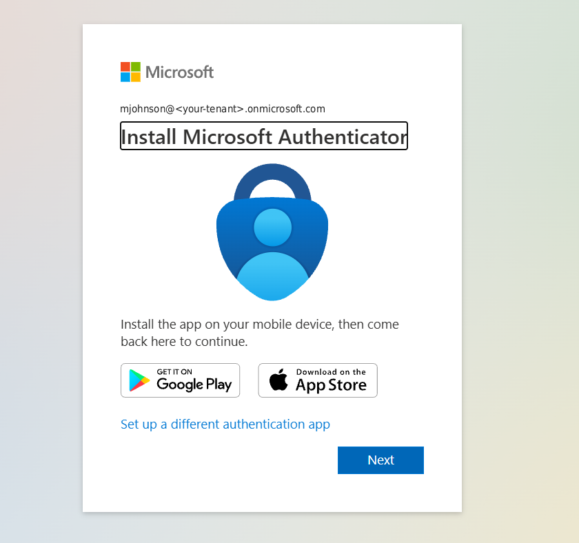

The portal shows "Don't have a subscription?" and no resources, because `mjohnson` holds no role anywhere. Signing in is not the same as having access.

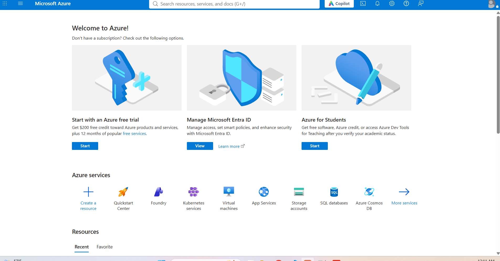

This is the second control: NIST SP 800-53 IA-2(2), multi-factor authentication for non-privileged accounts. In a real environment nobody should type a known password on someone else's behalf. The user resets their own, or an admin issues a one-time password that must be changed at first sign-in. This script is a lab shortcut, and its header says so.

## Step 8: Connect to the domain controller with Remote Desktop

**What this step does.** It shows what the cloud MFA does **not** cover.

**Before you run it.** You already signed in to the portal with MFA. When you connect to DC01 with Remote Desktop, will you be asked for it?

**What to do.** Use the same commands as in Step 3 to open the Remote Desktop client, sign in as `IAMLAB\labadmin`, and empty the clipboard afterwards.

```powershell
$ip = az vm list-ip-addresses -g rg-iamlab -n DC01 --query "[0].virtualMachine.network.publicIpAddresses[0].ipAddress" -o tsv
$env:TF_VAR_admin_password | Set-Clipboard
mstsc /v:$ip
Set-Clipboard -Value " "
```

**What you should see.** You are not asked for a second factor. Entra MFA protects sign-ins to Entra ID: the portal, Microsoft 365 and the apps behind them. Remote Desktop to the server checks the password against Active Directory and never asks Entra anything. The strongest account in the lab, the domain administrator, has one password between an attacker and the whole directory, while the weakest cloud user is made to use MFA. A real environment closes that gap with its own controls, such as a gateway or a jump host that requires MFA before anyone reaches the server, and no direct Remote Desktop from the internet. This lab only shows the gap.

This supports NIST SP 800-53 AC-17 (remote access), which asks you to control and authenticate remote connections. The NSG that allows one source IP is the only control on this one.

## Step 9: See what happens when a synced user leaves the scope

**What this step does.** The IAM lab's leaver script moves accounts into `OU=Disabled`, which is outside the sync scope. This step finds out what that does to an account that is already in the cloud. It uses the throwaway `scopetest` account, so no real user is touched.

**Before you run it.** `scopetest` is in Entra ID. You move him back into `OU=Disabled`. Will Entra ID disable him, delete him or leave him alone?

**What to do.** First move him **into** the scope and wait. Then move him back **out**.

```powershell
@'
Move-ADObject -Identity "CN=Scope Test,OU=Disabled,DC=iamlab,DC=local" -TargetPath "OU=IT,OU=Staff,DC=iamlab,DC=local"
Get-ADUser scopetest | Select-Object SamAccountName, Enabled, DistinguishedName | Format-List | Out-String
'@ | Set-Content check.ps1 -Encoding ascii
Send-ToDC check.ps1
```

Wait about five minutes and look at the **Users** list. In my lab the user did not appear, not even after 20 minutes. I could not find out why, and I do not know whether the scheduled sync notices an OU move at all. If you see the same, run **Provision on demand** with `CN=Scope Test,OU=IT,OU=Staff,DC=iamlab,DC=local`. It creates him.

Now move him back out:

```powershell
@'
Move-ADObject -Identity "CN=Scope Test,OU=IT,OU=Staff,DC=iamlab,DC=local" -TargetPath "OU=Disabled,DC=iamlab,DC=local"
Get-ADUser scopetest | Select-Object SamAccountName, Enabled, DistinguishedName | Format-List | Out-String
'@ | Set-Content check.ps1 -Encoding ascii
Send-ToDC check.ps1
```

Wait ten minutes. In my lab he was still listed. Then open the configuration's **Overview** page and click **Restart provisioning**. It clears the service's record of what it has already seen and re-checks every object. Wait a few minutes, refresh **Users**, and open **Users**, **Deleted users**.

**What you should see.** After the restart, the Users list is back to 20, and `Scope Test` is in **Deleted users**. Entra ID deleted him, softly: he can be restored for 30 days and is removed permanently after that. He was not disabled and not left alone. Provisioning logs for his ID show the whole life: a skipped Delete, a Create, two Updates and a final Delete.

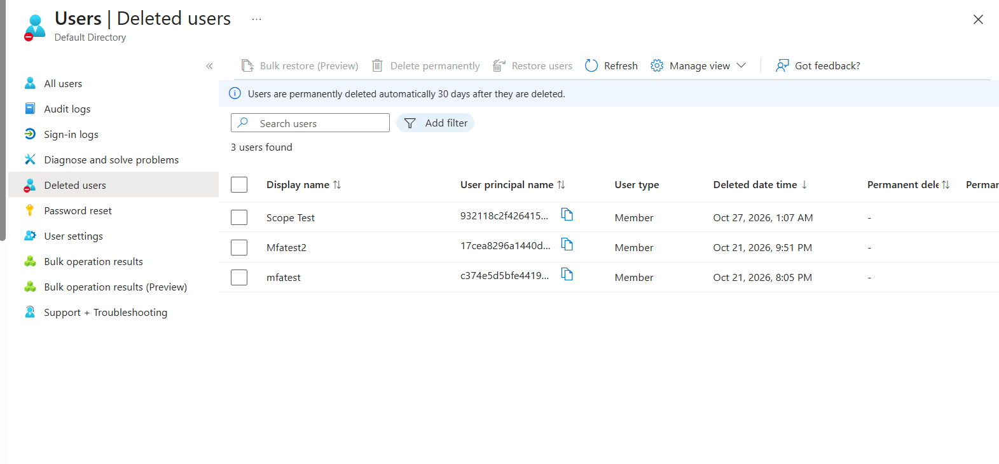

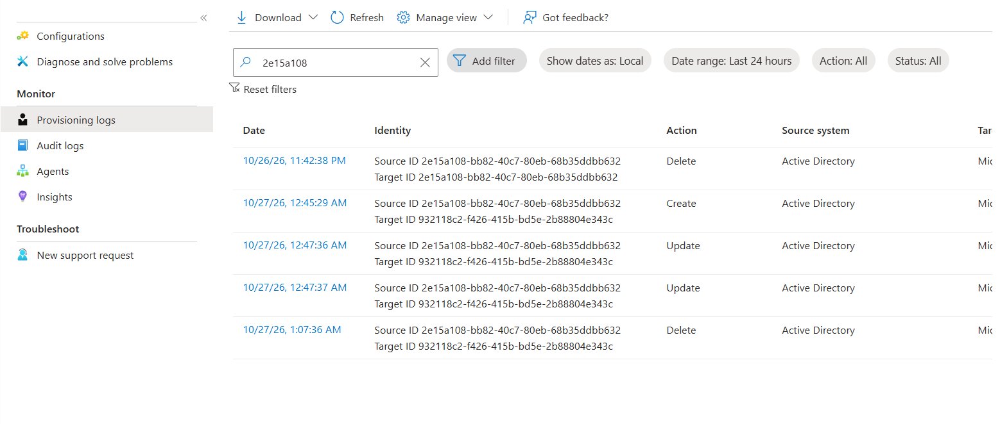

Two things matter beyond this lab. First, a person who moves out of the scope is removed from the cloud. That can be the right way to take a leaver's cloud access away, but it conflicts with the rule in Step 13 of the IAM lab to disable first and delete later: if your leaver process moves accounts out of the synced OU, the cloud account is deleted at the next evaluation, before anyone decided to delete anything. I did not test the leaver script on a synced user. Second, the sync did not react to an OU move on its own in this lab, within 20 minutes in or 10 minutes out. Microsoft's documentation does not say how it treats a move, so I cannot give you a reason. In Step 11 I found that the Overview page lists the provisioning interval as fixed at 20 minutes, so my waits of 10 to 20 minutes may simply have been too short, but I did not retest it. If your process relies on moves, force a re-check with Restart provisioning.

## Step 10: What the paid tiers add (reading only)

**What this step does.** Nothing is built here. It explains what a paid Entra ID plan adds to what you just saw, so you can say where the free version stops. I did not buy a paid plan, so none of this is tested.

What the free tier gave you in this lab:

- **Security defaults.** One switch that makes every user register for MFA, challenges administrators and Azure management sign-ins, and blocks old sign-in methods that cannot do MFA. It applies to everyone and has no exceptions, no conditions and no way to exclude an emergency account.
- **Sync from the directory to the cloud**, with password hash sync, as you built.
- **An Identity Secure Score**, a percentage that shows how many of Microsoft's recommended settings your tenant has. Mine started at 68.42%.

What a paid plan adds:

- **Conditional Access** (Entra ID P1). Rules of the form "if this user, on this app, from this place or device, then require MFA, or block". It replaces the one-size security defaults. You must turn security defaults off before you can use it.
- **Authentication strengths** (part of Conditional Access). You can require a specific kind of MFA for a sensitive app, for example a phishing-resistant method instead of a number match.
- **Sync from the cloud back to the directory.** The Cloud sync page said it needs a P1, P2 or Governance license to create an Entra-to-AD configuration. Group writeback, which sends cloud groups down to AD, is on the same side of that line.
- **Risk-based sign-in controls and just-in-time admin roles** (Entra ID P2). These are the next tier up, and I only know them from Microsoft's plan comparison.

The Remote Desktop gap from Step 8 does not close with a plan. A paid tier can require MFA for the cloud sign-ins that reach a server, but the server needs its own controls too. Check Microsoft's current plan comparison before you rely on any of this, because plans and names change.

## Step 11: Tear it down

**What this step does.** It removes everything this lab created, in an order that leaves nothing behind, and then deletes the server. The order matters. Microsoft's Cloud Sync FAQ says that deleting a configuration does not remove the users it created, so the sync has to remove them first. I followed that order and did not test the other one.

**Before you run it.** You are about to take the 18 synced users out of the scope. When the sync notices, will Entra ID disable them, delete them, or leave them alone?

**What to do.** Work through the parts in order. Every time shown below is my local time on the morning I ran it.

**Part 1: Empty the scope.** Pick an OU that has no users in it. I used `OU=Workstations,DC=iamlab,DC=local`. The agent has to read the directory to apply the change, so the server must be running. Check that the OU is empty (repeat the password and `Send-ToDC` parts of Step 1 first if you closed the terminal):

```powershell
az login
az vm start -g rg-iamlab -n DC01
Set-Content -Encoding ascii check.ps1 -Value '(Get-ADUser -Filter * -SearchBase "OU=Workstations,DC=iamlab,DC=local").Count'
Send-ToDC check.ps1
```

It prints `0`. Now open **Entra Connect > Cloud sync**, open `iamlab.local` and go to **Scoping filters**. Remove the `OU=Staff,DC=iamlab,DC=local` row. Keep **Sync selected organizational units** selected, type `OU=Workstations,DC=iamlab,DC=local` in the box in one go, and click **Add**. Check that exactly one row appears, then click **Save**. A "Configuration successfully saved" message appears.

Two things went wrong for me here. Typing the address and clicking Save without clicking **Add** saves nothing: the box still held the text, the page said "No scopes added yet", and Save was greyed out. And at one point the page showed **All users and groups** selected with no rows, and I could not tell whether that was saved or only how the page looks after the row is removed. Either way, it is not an empty scope. It is the widest one, so do not leave it there.

**Part 2: Restart provisioning and wait.** On the configuration's **Overview** page, click **Restart provisioning**. A "Restart was successful" message appears. Nothing happened for several minutes, and the Users list stayed at 20. Scroll down on the Overview page and expand **Provisioning details** under **Current cycle status**. It says the provisioning interval is fixed at 20 minutes. In my lab, by my notes, I clicked Restart at about 2:12 AM, and the cycle that did the work started at 2:20:58 AM and finished at 2:21:05 AM, 6.9 seconds later. I cannot say whether my restart or the 20-minute schedule started that cycle: 2:20:58 is exactly 20 minutes after a batch of log rows at 2:00:59, but the log also shows a batch at 2:06:45 that I cannot account for. Plan for up to 20 minutes.

**Part 3: Check what the sync did.** Refresh the **Users** list, then open **Users > Deleted users**. Open the tenant's **Audit logs** as well.

**Part 4: Delete the configuration.** On the configuration's **Overview** page, Microsoft's FAQ says to disable the configuration and then delete it. **Delete configuration** has no confirmation prompt: it acts the moment you click it. I clicked Delete without disabling first, by accident, and the portal said "The configuration was deleted successfully". The Configurations list then said "To get started, create a new configuration". I cannot tell you that Disable is required, but I would still do it in that order.

**Part 5: Uninstall the agent on DC01.** Remote Desktop into DC01 and open **Settings > Apps > Apps & features**. Five entries were listed: Microsoft Entra Provisioning Agent Package (1.1.2507.0), Microsoft Azure AD Connect Provisioning Agent, Microsoft Azure AD Connect Agent Updater (1.5.4724.0), Microsoft .NET 6.0.47 Windows Server Hosting, and Microsoft Edge. The installer still uses the old "Azure AD" names for two of them. Open the package, click **Uninstall**, and then click **Uninstall** again in its setup window. Check the list afterwards.

Then open **Entra Connect > Cloud sync > Agents** in the portal, the page with the **Download on-premises agent** button. Do not confuse it with the **Agents** page under Entra's agent identities, which is a different feature and showed 0.

**Part 6: Destroy the server.** This is Step 18 of the IAM lab. Close your Remote Desktop window first. The server must be running, because Terraform powers a VM off before it deletes it. Run these from the folder where you built the IAM lab:

```powershell
az login
az vm start -g rg-iamlab -n DC01
cd <the folder where you built the IAM lab>
$env:TF_VAR_admin_password.Length
terraform plan -destroy -out destroy.tfplan
terraform apply destroy.tfplan
az group exists -n rg-iamlab
Remove-Item destroy.tfplan
```

If the password length prints 0, reload the password from the Key Vault as in Step 1. Then check the Agents page in the portal again.

**Part 7: Delete the `syncadmin` account.** You are signed in as `syncadmin`, so use your other administrator for this. Open a private window, sign in to the Entra admin center as that account, go to **Users > All users**, open **Sync Admin** and click **Delete**. Then open **Deleted users**.

**Part 8: Clear the Authenticator entries.** On your phone, open Microsoft Authenticator. For each lab account, tap the entry, tap the gear icon and choose **Remove account**. This removes only the entry on the phone. Leave your own entries alone.

**What you should see.** Here is what I saw, part by part:

- **Part 1 and 2:** the OU check printed `0`, the scope saved with a single row, and the restart reported success.
- **Part 3:** the Users list dropped from 20 to **2 users found**, the two cloud-only accounts, both with On-premises sync set to No. **Deleted users** listed the synced users, and every row I looked at was stamped Oct 27, 2:21 AM. The Audit log shows 18 **Delete user** entries at 2:21:04 AM, made by the sync service. Each one has a matching "staged for deletion" entry and a "was deleted in Microsoft Entra ID" entry from Cloud Sync. Entra ID deleted them. It did not disable them. They are soft-deleted: the Deleted users page says users are permanently deleted automatically 30 days after they are deleted, and I left them there.
- **Part 4:** the Configurations list was empty.
- **Part 5:** uninstalling the package removed both the package entry and the Provisioning Agent entry, but the Agent Updater stayed in the list. The list showed three apps. I uninstalled the Updater separately. The installer asked to close the Updater itself, and I left **Automatically close applications** selected and clicked **OK**. The list ended with .NET hosting and Edge. I left .NET hosting alone, because the server is deleted in Part 6. The portal's Agents page still listed DC01 as **active** right after the uninstall.
- **Part 6:** the plan said **0 to add, 0 to change, 13 to destroy**. The apply ended with `Apply complete! Resources: 0 added, 0 changed, 13 destroyed.` and `az group exists` printed `false`. Terraform also warned that my `terraform.tfvars` held values for variables the configuration does not declare. That did not affect the destroy. As the IAM lab says, the Key Vault stays in soft delete for 7 days and the state storage stays. At 2:48 AM, after the uninstall and after the server was gone, the Agents page **still showed DC01 as active**. Microsoft's FAQ says an uninstalled agent goes Inactive after about an hour and is removed after about 10 days. I did not watch long enough to see it change, so I cannot tell you how long the portal takes.
- **Part 7:** "Sync Admin has been deleted", and `Sync Admin` appeared in **Deleted users**, stamped 2:49 AM, the same soft delete as the synced users.
- **Part 8:** nothing to see in the portal.

## Why I designed it this way

**Build on the IAM lab instead of rebuilding it.** The interesting part here is the join between a directory and the cloud. A second domain would add nothing, and the leavers and movers from the IAM lab give the sync something real to scope.

**Free tier on purpose.** Everything here runs on Entra ID Free with security defaults. That is enough to show that a synced user is forced to register for MFA, and enough to show where the protection stops. Step 10 says what a paid plan adds, without claiming I tested it.

**Cloud Sync, scoped by OU.** Cloud Sync needs only a small agent on the domain controller and is configured in the portal, so there is no separate sync server to run. Scoping by OU puts the decision about what leaves the building into the directory's own structure: staff are in `Staff`, leavers are moved out. That also means the OU is a boundary for the cloud copy, so moving an account is a cloud-side event.

**Show the gap, not only the control.** The MFA test passes, and the Remote Desktop test shows that the same account gets into the domain controller with no second factor. A control is only worth describing next to what it does not cover.

**Empty the scope before deleting the configuration.** Microsoft's FAQ says the users a configuration created stay in the tenant when you delete it. Pointing the scope at an OU with no users makes the sync remove them itself, and only then does the configuration, the agent and the server go.

**A known password only as a lab shortcut.** The 18 synced users have random passwords nobody knows, so one script sets a known password for two of them. It ships in dry-run mode, takes the password at run time, and says in its header that a real environment would never do this.

## What I took from this

The sync half taught me the same lesson as the IAM lab, from the other side: a green tick is not the same as a correct result. Provision on demand showed a green "in scope" tick for users who were not in scope, and only the last step said skipped. My first two tests failed because I typed a user name where the box wanted a full distinguished name, and the error read like a scope problem. I expected a leaver moved out of the synced OU to be disabled in the cloud. It was deleted, softly, and recoverable for 30 days.

I could not explain why the scheduled sync ignored an OU move that a forced restart then acted on. Microsoft's documentation does not say how the scheduled sync treats a move. The fixed 20-minute interval I found later may be part of the answer, since I waited 10 to 20 minutes, but the log also shows a batch I cannot account for, so I left it as unexplained instead of guessing.

The teardown held its own surprise. After I restarted provisioning, nothing happened for about nine minutes, and then one cycle of under seven seconds deleted all 18 users. Deleting the configuration first would have left them in the tenant. The agent was the last loose end: the portal still showed it active after the uninstall and after the server was gone, and I did not see how long it takes to change.

The Remote Desktop result is the one I will remember. The cloud side made every user register for MFA, and the server that holds all of them let me in with a password.

I would extend this with a Conditional Access policy on a paid tier, and with a test of the IAM lab's leaver script on a user who is already synced.
